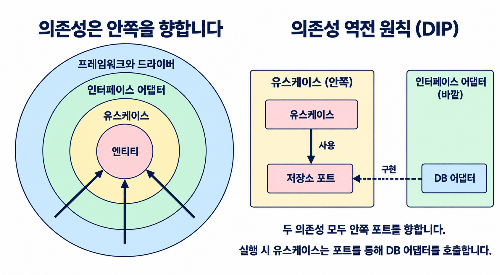

<div align="center">


# Clean Architecture Skills

**경계는 명확하게. 코드는 단순하게.**

아키텍처를 검토하고, 코드 냄새를 찾고, 작은 단계로 코드를 개선하는 AI 코딩 에이전트용 스킬 두 가지.

[](https://github.com/nathankim0/clean-architecture-skills/releases) [](https://github.com/nathankim0/clean-architecture-skills/actions/workflows/validate.yml) [](LICENSE)

[English](README.md) · 한국어

[스킬](#skills) · [빠른 시작](#quick-start) · [사용법](#usage) · [지원 도구](#supported-agents) · [기여하기](#contributing)

</div>

<a id="skills"></a>
## 스킬

| 스킬 | 검토하는 내용 |
| --- | --- |
| **[Clean Architecture](plugins/clean-architecture/skills/clean-architecture/SKILL.md)** | 의존성 방향, 레이어 경계, SOLID를 검토하고 비즈니스 규칙을 인프라와 분리합니다. |
| **[Kent Beck Style](plugins/kent-beck-style/skills/kent-beck-style/SKILL.md)** | 코드 냄새를 찾고 이름을 명확하게 다듬으며, 동작을 유지하는 작은 리팩터링을 제안합니다. |

각 스킬을 따로 사용하거나, 설계를 검토한 뒤 구현을 단순하게 다듬는 데 함께 사용할 수 있습니다. 각 스킬은 이식 가능한 `SKILL.md` 파일이며, 모든 도구에서 같은 지침을 공유합니다.

<a id="quick-start"></a>
## 빠른 시작

### Claude Code

Claude Code 안에서 실행합니다. 원하는 플러그인만 설치하거나 둘 다 설치하세요.

```text
/plugin marketplace add nathankim0/clean-architecture-skills
/plugin install clean-architecture@clean-architecture-skills
/plugin install kent-beck-style@clean-architecture-skills
```

### OpenAI Codex

터미널에서 실행합니다.

```bash
codex plugin marketplace add nathankim0/clean-architecture-skills
codex plugin add clean-architecture@clean-architecture-skills
codex plugin add kent-beck-style@clean-architecture-skills
```

설치 후 새 Codex 세션을 시작합니다. `/plugins`로 마켓플레이스를 탐색할 수 있습니다. IDE 확장이나 `codex plugin` 명령이 없는 버전에서는 [수동 설치](#manual-installation)를 사용하세요.

Windows 플러그인 설치에는 [Git 심볼릭 링크 지원](https://gitforwindows.org/symbolic-links)이 필요합니다. 개발자 모드나 링크 생성 권한을 활성화하고 `core.symlinks=true`로 복제하세요. 링크를 사용할 수 없다면 스킬 디렉터리에 수동으로 설치합니다.

**다른 도구를 사용하나요?** [pi](#pi), [OpenClaw](#openclaw), [GitHub Copilot / Amp](#github-copilot-and-amp), [수동 설치](#manual-installation)로 바로 이동하세요.

<a id="usage"></a>
## 사용법

설치 후 평소처럼 요청하면서 사용할 스킬을 지정합니다.

```text
clean-architecture로 src/domain의 의존성을 검토해줘.
위반 사항을 찾고 각 경계가 왜 중요한지 설명해줘.
```

```text
kent-beck-style로 이 모듈을 검토해줘.
동작을 유지하면서 의도가 더 잘 드러나도록 작은 리팩터링을 제안해줘.
```

두 스킬을 함께 사용하려면:

```text
clean-architecture와 kent-beck-style로 이 기능을 검토해줘.
의존성 방향을 확인한 뒤, 코드를 이해하고 유지보수하기 쉬워지는
최소한의 변경을 제안해줘.
```

새 기능 설계, YAGNI·KISS 검토, 이름 개선, 긴 메서드의 리팩터링도 요청할 수 있습니다.

<details>
<summary><strong>Codex와 pi에서 스킬을 직접 선택하기</strong></summary>

Codex에서는 `/skills`를 열거나 설치한 플러그인 스킬의 이름을 직접 지정합니다.

```text
$clean-architecture:clean-architecture src/domain의 의존성을 검토해줘.
$kent-beck-style:kent-beck-style 이 모듈의 코드 냄새를 찾고 작은 리팩터링을 제안해줘.
```

pi에서는 `/skill:clean-architecture` 또는 `/skill:kent-beck-style`로 호출합니다.

</details>

<a id="supported-agents"></a>
## 지원 도구

| 도구 | 설치 방법 |
| --- | --- |
| **Claude Code** | [플러그인 마켓플레이스](#quick-start) |
| **OpenAI Codex** | [플러그인 마켓플레이스](#quick-start) 또는 [공통 스킬 디렉터리](#manual-installation) |
| **pi** | [Git 패키지](#pi) |
| **OpenClaw** | [Skills CLI](#openclaw) |
| **GitHub Copilot** | [GitHub CLI](#github-copilot-and-amp) 또는 [공통 스킬 디렉터리](#manual-installation) |
| **Amp** | [GitHub CLI](#github-copilot-and-amp) 또는 [공통 스킬 디렉터리](#manual-installation) |
| **Cursor** | [로컬 스킬 디렉터리](#manual-installation) |
| **Gemini CLI** | [로컬 스킬 디렉터리](#manual-installation) |
| **OpenCode** | [로컬 스킬 디렉터리](#manual-installation) |

중복 등록을 피하려면 도구마다 설치 방법을 하나만 선택하세요.

<a id="pi"></a>
<details>
<summary><strong>pi</strong> — Git 패키지로 설치</summary>

```bash
pi install git:github.com/nathankim0/clean-architecture-skills
```

실행 중인 세션에서 `/reload`를 실행한 뒤 `/skill:clean-architecture` 또는 `/skill:kent-beck-style`로 호출합니다. `pi list`로 설치한 패키지를 확인합니다.

로컬 복제본을 설치하려면 저장소 루트에서 `pi install .`을 실행합니다.

</details>

<a id="openclaw"></a>
<details>
<summary><strong>OpenClaw</strong> — Skills CLI로 설치</summary>

OpenClaw Gateway가 실행되는 컴퓨터에서 저장소를 복제하고 원하는 스킬을 설치합니다.

```bash
git clone https://github.com/nathankim0/clean-architecture-skills.git
cd clean-architecture-skills
openclaw skills install ./plugins/clean-architecture/skills/clean-architecture --global
openclaw skills install ./plugins/kent-beck-style/skills/kent-beck-style --global
openclaw skills list --eligible
```

설치 후 새 세션을 시작합니다. 설치 명령은 스킬 폴더를 복사하므로, `git pull`로 갱신한 뒤에는 설치 명령에 `--force`를 붙여 다시 실행합니다.

</details>

<a id="github-copilot-and-amp"></a>
<details>
<summary><strong>GitHub Copilot / Amp</strong> — GitHub CLI로 설치</summary>

스킬을 사용할 Git 저장소에서 도구에 맞는 명령을 선택해 실행합니다.

```bash
# GitHub Copilot
gh skill install nathankim0/clean-architecture-skills --all --agent github-copilot --scope project

# Amp
gh skill install nathankim0/clean-architecture-skills --all --agent amp --scope project
```

두 명령 모두 `.agents/skills/`에 설치하므로 같은 프로젝트에서는 한 번 설치한 스킬을 두 도구가 함께 사용합니다. `gh skill list --scope project`로 확인한 뒤, 새 세션에서 `clean-architecture` 또는 `kent-beck-style`을 사용하도록 요청하세요.

설정한 클라이언트에서 `copilot skill list` 또는 `amp skill list`로 스킬 인식 여부를 확인할 수 있습니다.

Copilot cloud agent와 Copilot code review에서도 사용하려면 설치한 `.agents/skills/` 폴더를 대상 저장소에 커밋합니다. 개인용으로 설치하려면 `--scope project` 대신 `--scope user`를 사용합니다.

GitHub CLI에 `gh skill` 명령이 없다면 [수동 설치](#manual-installation)를 사용하세요.

</details>

<a id="manual-installation"></a>
<details>
<summary><strong>수동 설치</strong> — 공통 디렉터리와 다른 도구</summary>

저장소를 복제한 뒤 원하는 스킬을 `~/.agents/skills/`에 연결합니다. Codex, GitHub Copilot, Amp, pi가 이 공통 디렉터리를 탐색합니다.

아래 명령은 macOS 또는 Linux 셸에서 실행합니다.

```bash
git clone https://github.com/nathankim0/clean-architecture-skills.git
cd clean-architecture-skills
mkdir -p ~/.agents/skills
ln -s "$PWD/plugins/clean-architecture/skills/clean-architecture" ~/.agents/skills/
ln -s "$PWD/plugins/kent-beck-style/skills/kent-beck-style" ~/.agents/skills/
```

특정 프로젝트에서만 사용하려면 대상 프로젝트의 `.agents/skills/`에 스킬 폴더를 연결하거나 복사합니다. Windows에서는 도구의 스킬 디렉터리로 폴더를 복사하거나, 사용하는 셸의 명령으로 디렉터리 링크를 만듭니다.

스킬이 표시되지 않으면 다시 불러오거나 새 세션을 시작하세요. 링크가 유지되도록 복제본의 경로를 그대로 둡니다. 연결한 스킬은 `git pull`로 갱신되고, 복사한 폴더는 갱신 후 다시 복사해야 합니다. 이미 설치한 스킬이 있다면 기존 폴더를 다른 위치로 옮긴 뒤 링크를 만드세요.

다른 도구에서는 **`SKILL.md`가 들어 있는 개별 스킬 폴더**를 아래 디렉터리에 연결하거나 복사합니다.

| 도구 | 스킬 디렉터리 |
| --- | --- |
| Cursor | 대상 프로젝트의 `.cursor/skills/` |
| Gemini CLI | `~/.gemini/skills/` |
| OpenCode | `~/.config/opencode/skills/` |
| OpenClaw | `~/.openclaw/skills/` (기본 공용 관리 디렉터리) |
| pi | `~/.pi/agent/skills/` |
| GitHub Copilot | `.agents/skills/` (프로젝트) 또는 `~/.copilot/skills/` (개인) |
| Amp | `.agents/skills/` (프로젝트) 또는 `~/.config/agents/skills/` (개인) |

OpenClaw도 기본 상태 디렉터리를 사용할 때는 `~/.agents/skills/`를 탐색합니다. 상태 디렉터리를 변경했다면 [Skills CLI](#openclaw)를 사용하세요.

</details>

## 설계 원칙

### 의존성은 안쪽을 향합니다

**비즈니스 규칙을 독립적으로 유지합니다.** 소스 코드 의존성은 더 높은 수준의 정책이 있는 안쪽을 향합니다.



동심원은 레이어의 포함 관계와 경계를 보여줍니다. 화살표는 실행 순서가 아니라 소스 코드 의존성을 뜻합니다. 이 방향을 지키면서 중간 레이어를 건너뛸 수도 있습니다. 원형 자체나 정확히 네 개의 레이어가 필수인 것은 아니며, 의존성 규칙이 핵심입니다. [Robert C. Martin의 원문](https://blog.cleancoder.com/uncle-bob/2012/08/13/the-clean-architecture.html)을 참고하세요.

### 의존성 역전 원칙 (DIP)

**고수준 정책과 저수준 세부사항은 추상화에 의존하고, 추상화는 구현 세부사항에 의존하지 않습니다.** 위 그림의 오른쪽처럼 포트(인터페이스)를 사용하는 안쪽 레이어에 정의하고, 바깥 어댑터가 이를 구현합니다.

예를 들어 `GetUserUseCase`는 `UserRepository`만 참조하고, 바깥의 `PostgresUserRepository`가 이 포트를 구현합니다. 실행 시 유스케이스는 포트를 통해 전달받은 구현체를 호출합니다. 이렇게 호출은 바깥으로 향해도 코드 의존성은 안쪽으로 유지됩니다. 의존성 주입(DI)은 구현체를 전달하는 수단이며, 유스케이스가 구체 클래스에 의존한다면 주입만으로 DIP가 성립하지는 않습니다.

### 작은 단계의 리팩터링

**작은 단계로 코드를 개선합니다.** 켄트 벡의 단순한 설계 우선순위를 따릅니다. 테스트를 통과하고, 의도를 드러내고, 중복을 줄이고, 불필요한 요소를 덜어냅니다. 추상화는 실제 문제를 해결할 때 도입합니다.

전체 검토 체크리스트, 보고서 형식, TypeScript·Python·Java/Kotlin 예제는 [Clean Architecture 스킬](plugins/clean-architecture/skills/clean-architecture/SKILL.md)과 [Kent Beck Style 스킬](plugins/kent-beck-style/skills/kent-beck-style/SKILL.md)에서 확인할 수 있습니다.

<a id="contributing"></a>
## 기여하기

이슈와 PR을 환영합니다. 구체적인 리뷰 예시, 더 명확한 지침, 검증한 도구별 설치 방법을 제안해 주세요.

- 공통 지침은 `plugins/<name>/skills/<name>/SKILL.md`에서 수정합니다.
- 각 플러그인의 `.codex-plugin/plugin.json`만 수정합니다. `.claude-plugin/plugin.json`은 이 원본을 가리키는 상대 심볼릭 링크입니다. 마켓플레이스 목록은 스키마가 달라 별도로 관리합니다.
- 영문·한글 README를 함께 갱신합니다.

**Node.js 24 이상**에서 검증합니다. 별도로 설치할 의존성은 없습니다.

```bash
node --test
```

GitHub Actions가 Linux와 Windows에서 플러그인 메타데이터와 스킬의 실행 가능한 예제를 검증합니다.

## 참고 자료

- [The Clean Architecture — Robert C. Martin](https://blog.cleancoder.com/uncle-bob/2012/08/13/the-clean-architecture.html)
- [Refactoring과 리팩터링 카탈로그 — Martin Fowler](https://refactoring.com/)
- [Implementation Patterns — Kent Beck](https://www.amazon.com/Implementation-Patterns-Kent-Beck/dp/0321413091)

<details>
<summary><strong>도구별 공식 문서</strong></summary>

| 도구 | 문서 |
| --- | --- |
| Claude Code | [플러그인 마켓플레이스](https://code.claude.com/docs/en/plugin-marketplaces) |
| OpenAI Codex | [스킬](https://developers.openai.com/codex/skills/) · [플러그인 패키징](https://developers.openai.com/plugins/build/plugins) |
| pi | [스킬](https://pi.dev/docs/latest/skills) · [패키지](https://pi.dev/docs/latest/packages) |
| OpenClaw | [스킬](https://docs.openclaw.ai/tools/skills) · [Skills CLI](https://docs.openclaw.ai/cli/skills) |
| GitHub Copilot | [Agent Skills](https://docs.github.com/en/copilot/concepts/agents/about-agent-skills) · [GitHub CLI 설치](https://cli.github.com/manual/gh_skill_install) |
| Amp | [스킬](https://ampcode.com/docs/customize/skills) |

</details>

## 라이선스

[MIT](LICENSE) — 자유롭게 사용하고, 수정하고, 공유하세요.
