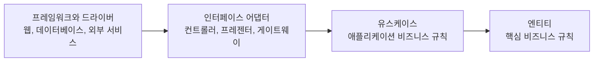

# Clean Architecture Skills

[](README.md)

**클린 아키텍처**와 **켄트 벡의 단순한 설계 철학**에 따라 코드 리뷰, 아키텍처 설계 가이드, 리팩터링 제안을 제공하는 AI 코딩 에이전트용 스킬 모음입니다.

**Claude Code**와 **OpenAI Codex**의 플러그인 마켓플레이스, **pi**의 Git 패키지 설치, **OpenClaw**의 스킬 설치 명령을 지원합니다. 로컬 스킬 디렉터리를 사용하는 다른 AI 코딩 도구에서도 같은 `SKILL.md` 파일을 사용할 수 있습니다.

**GitHub Copilot**과 **Amp**에서는 GitHub CLI로 두 스킬을 설치하거나 공통 Agent Skills 디렉터리에서 불러올 수 있습니다.

## 포함된 스킬

### 클린 아키텍처

로버트 C. 마틴의 클린 아키텍처 원칙에 따라 코드를 검토하고 설계를 안내합니다.

- **의존성 규칙** — 잘못된 방향으로 향하는 의존성을 찾습니다.
- **레이어 경계** — 엔티티, 유스케이스, 인터페이스 어댑터, 인프라를 검토합니다.
- **의존성 역전** — 아키텍처 경계를 넘는 통신을 설계합니다.
- **SOLID 원칙** — SRP, OCP, LSP, ISP, DIP를 검토합니다.
- **아키텍처 설계** — 비즈니스 규칙이 프레임워크에 결합되지 않도록 새 기능을 설계합니다.

### 켄트 벡 스타일

켄트 벡의 리팩터링 철학과 단순한 설계 원칙에 따라 코드를 검토합니다.

- **코드 냄새** — 구조와 가독성의 문제를 찾습니다.
- **리팩터링** — 동작을 유지하는 작은 개선을 제안합니다.
- **단순한 설계** — YAGNI, KISS, 단순한 설계의 네 가지 규칙을 적용합니다.
- **의도가 드러나는 코드** — 이름을 개선하고 코드를 이해하기 쉽게 만듭니다.
- **점진적 개선** — 대규모 재작성보다 작고 안전한 변경을 우선합니다.

---

## 설치

### Claude Code

이 저장소를 플러그인 마켓플레이스로 추가합니다.

```bash
/plugin marketplace add nathankim0/clean-architecture-skills
```

그다음 사용할 스킬을 설치합니다.

#### 클린 아키텍처

```bash
/plugin install clean-architecture@clean-architecture-skills
```

#### 켄트 벡 스타일

```bash
/plugin install kent-beck-style@clean-architecture-skills
```

각 스킬을 따로 설치하거나 함께 사용할 수 있습니다.

### OpenAI Codex

터미널에서 다음 명령을 실행해 마켓플레이스를 추가하고 원하는 플러그인을 설치합니다.

```bash
codex plugin marketplace add nathankim0/clean-architecture-skills
codex plugin add clean-architecture@clean-architecture-skills
codex plugin add kent-beck-style@clean-architecture-skills
```

설치 후 새 Codex 세션을 시작합니다. Codex CLI의 `/plugins`에서도 등록한 마켓플레이스를 탐색할 수 있습니다.

Codex IDE 확장이나 `codex plugin` 명령이 없는 버전에서는 아래 수동 설치 방법을 사용합니다.

### pi

두 스킬을 하나의 pi 패키지로 설치합니다.

```bash
pi install git:github.com/nathankim0/clean-architecture-skills
```

실행 중인 pi 세션에서 `/reload`를 실행한 뒤 `/skill:clean-architecture` 또는 `/skill:kent-beck-style`로 호출합니다. `pi list`로 설치한 패키지를 확인할 수 있습니다. 로컬 복제본을 설치하려면 저장소 루트에서 `pi install .`을 실행합니다.

### GitHub Copilot과 Amp

스킬을 사용할 Git 저장소에서 도구에 맞는 명령을 선택해 실행합니다.

```bash
# GitHub Copilot
gh skill install nathankim0/clean-architecture-skills --all --agent github-copilot --scope project

# Amp
gh skill install nathankim0/clean-architecture-skills --all --agent amp --scope project
```

두 명령 모두 `.agents/skills/`에 설치하므로 같은 프로젝트에서는 한 번 설치한 스킬을 두 도구가 함께 사용할 수 있습니다. `gh skill list --scope project`로 설치한 스킬을 확인한 뒤, Copilot이나 Amp에서 새 세션을 시작하고 `clean-architecture` 또는 `kent-beck-style`을 사용해 검토하도록 요청합니다.

설정한 클라이언트에서 `copilot skill list` 또는 `amp skill list`로 실제 스킬 인식 여부도 확인할 수 있습니다.

Copilot cloud agent와 Copilot code review에서도 사용하려면 설치한 `.agents/skills/` 폴더를 대상 저장소에 커밋합니다. 개인용으로 설치하려면 `--scope project` 대신 `--scope user`를 사용합니다. GitHub CLI에 `gh skill` 명령이 없다면 아래 수동 설치 방법을 사용합니다.

### 수동 설치

저장소를 복제합니다.

```bash
git clone https://github.com/nathankim0/clean-architecture-skills.git
cd clean-architecture-skills
```

#### OpenClaw

복제한 저장소에서 원하는 스킬을 OpenClaw의 공용 관리 스킬 디렉터리에 설치합니다.

```bash
openclaw skills install ./plugins/clean-architecture/skills/clean-architecture --global
openclaw skills install ./plugins/kent-beck-style/skills/kent-beck-style --global
openclaw skills list --eligible
```

OpenClaw Gateway가 실행되는 컴퓨터에서 명령을 실행합니다. 설치 후 새 세션을 시작합니다. 이 명령은 스킬 폴더를 복사하므로, `git pull`로 갱신한 뒤에는 설치 명령에 `--force`를 붙여 다시 실행합니다.

#### 공통 Agent Skills 디렉터리

Codex, GitHub Copilot, Amp, pi 등 `~/.agents/skills/`를 탐색하는 도구에서는 원하는 스킬 폴더를 해당 디렉터리에 심볼릭 링크로 연결합니다.

```bash
mkdir -p ~/.agents/skills
ln -s "$PWD/plugins/clean-architecture/skills/clean-architecture" ~/.agents/skills/
ln -s "$PWD/plugins/kent-beck-style/skills/kent-beck-style" ~/.agents/skills/
```

특정 프로젝트에서만 사용하려면 `~/.agents/skills/` 대신 해당 프로젝트의 `.agents/skills/` 디렉터리를 사용합니다. 스킬이 표시되지 않으면 사용하는 도구에서 다시 불러오거나 새 세션을 시작합니다. 중복 등록을 피하려면 도구마다 설치 방법을 하나만 선택합니다.

OpenClaw도 기본 상태 디렉터리를 사용할 때는 이 공통 사용자 디렉터리를 탐색합니다. 상태 디렉터리를 변경했다면 위의 OpenClaw 설치 명령을 사용합니다.

연결한 스킬은 이 복제본에서 `git pull`을 실행하면 함께 갱신됩니다. 링크가 유지되도록 복제본의 경로를 그대로 둡니다. 이전에 스킬을 복사해 설치했다면 기존 설치 폴더를 다른 위치로 옮긴 뒤 링크를 만듭니다.

다른 AI 도구에서는 아래 디렉터리에 같은 스킬 폴더를 연결하거나 복사합니다.

### 다른 AI 코딩 도구

| 도구 | 스킬 디렉터리 |
|---|---|
| **Cursor** | `.cursor/skills/` |
| **Gemini CLI** | `~/.gemini/skills/` |
| **OpenCode** | `~/.config/opencode/skills/` |
| **OpenClaw** | `~/.openclaw/skills/` (기본 공용 관리 디렉터리) |
| **pi** | `~/.pi/agent/skills/` |
| **GitHub Copilot** | `.agents/skills/` (프로젝트) 또는 `~/.copilot/skills/` (개인) |
| **Amp** | `.agents/skills/` (프로젝트) 또는 `~/.config/agents/skills/` (개인) |

---

## 사용법

일반적인 요청만으로도 스킬을 사용할 수 있습니다.

Codex에서는 `/skills`로 스킬을 선택하거나 이름을 직접 지정합니다.

```text
$clean-architecture:clean-architecture src/domain의 의존성을 검토해줘.
$kent-beck-style:kent-beck-style 이 모듈의 코드 냄새를 찾고 작은 리팩터링을 제안해줘.
```

### 프로젝트 전체 검토

```text
클린 아키텍처 원칙에 따라 이 프로젝트를 검토해줘.
```

### 특정 모듈 검토

```text
src/domain의 의존성을 확인하고 클린 아키텍처 위반 사항을 찾아줘.
```

### 새 기능 설계

```text
클린 아키텍처를 적용해 사용자 인증 기능을 설계해줘.
```

### 코드 냄새 검토

```text
이 코드에서 코드 냄새를 찾고 리팩터링 방법을 제안해줘.
```

### 기존 코드 리팩터링

```text
켄트 벡의 접근법으로 이 긴 메서드를 리팩터링해줘.
```

### 설계의 단순함 검토

```text
이 구현이 YAGNI와 KISS 원칙을 따르는지 확인해줘.
```

### 이름 개선

```text
이 모듈의 이름과 가독성을 개선해줘.
```

### 두 스킬 함께 사용

```text
이 기능의 클린 아키텍처 위반 사항을 검토한 뒤, 구현을 단순하게 만드는 작은 리팩터링을 제안해줘.
```

---

## 클린 아키텍처

### 의존성 규칙

클린 아키텍처의 핵심 규칙은 다음과 같습니다.

> 소스 코드의 의존성은 더 높은 수준의 정책이 있는 안쪽을 향해야 합니다.



화살표는 바깥쪽 구현 세부사항에서 안쪽 비즈니스 규칙으로 향하는 소스 코드 의존성을 나타냅니다. 안쪽을 향하는 방향을 지킨다면 중간 레이어를 건너뛸 수도 있습니다.

비즈니스 규칙은 데이터베이스, 프레임워크, UI 라이브러리, 외부 API에 의존하지 않아야 합니다.

구현 세부사항이 비즈니스 규칙에 가까운 레이어에서 정의한 추상화에 의존하도록 설계합니다.

### 레이어별 책임

| 레이어 | 책임 | 예시 |
|---|---|---|
| **엔티티** | 핵심 비즈니스 규칙 | `User`, `Order`, `Product` |
| **유스케이스** | 애플리케이션에 특화된 비즈니스 규칙 | `CreateOrder`, `GetUserProfile` |
| **인터페이스 어댑터** | 레이어 사이의 데이터 변환 | 컨트롤러, 프레젠터, 게이트웨이 |
| **프레임워크와 드라이버** | 외부 구현 세부사항 | React, Express, PostgreSQL |

### SOLID 원칙

| 원칙 | 설명 |
|---|---|
| **SRP** — 단일 책임 | 모듈이 변경되는 이유는 하나여야 합니다. |
| **OCP** — 개방·폐쇄 | 확장에는 열려 있고 수정에는 닫혀 있어야 합니다. |
| **LSP** — 리스코프 치환 | 하위 타입은 상위 타입을 대체할 수 있어야 합니다. |
| **ISP** — 인터페이스 분리 | 사용하지 않는 인터페이스에 의존하지 않아야 합니다. |
| **DIP** — 의존성 역전 | 구체적인 구현보다 추상화에 의존해야 합니다. |

---

## 켄트 벡 스타일

이 스킬은 기존 코드를 **더 단순하고 명확하게, 변경하기 쉽게 만드는 것**에 초점을 맞춥니다.

### 단순한 설계

다음 조건을 순서대로 만족하는 코드를 지향합니다.

1. 테스트를 통과합니다.
2. 의도가 드러납니다.
3. 중복이 없습니다.
4. 불필요한 요소가 가장 적습니다.

다음 원칙도 함께 적용합니다.

- **YAGNI** — 필요해지기 전에 기능을 만들지 않습니다.
- **KISS** — 현재 문제를 해결하는 가장 단순한 설계를 선택합니다.
- **작은 단계** — 점진적으로 리팩터링합니다.
- **동작 보존** — 동작을 바꾸지 않고 구조를 개선합니다.
- **의도가 드러나는 이름** — 코드 자체로 의도를 설명합니다.

### 코드 냄새

다음과 같은 코드 냄새를 찾을 수 있습니다.

- 비대해진 코드
- 객체 지향의 잘못된 사용
- 변경을 어렵게 만드는 구조
- 불필요한 코드
- 과도한 결합

문제에 맞는 구체적인 리팩터링을 제안합니다.

---

## 프로젝트 구조 예시

클린 아키텍처를 적용한 프로젝트의 예시입니다.

```text
src/
├── domain/                         # 엔티티
│   ├── entities/
│   │   ├── User.ts
│   │   └── Order.ts
│   └── value-objects/
│       └── Email.ts
│
├── application/                    # 유스케이스
│   ├── use-cases/
│   │   ├── CreateOrderUseCase.ts
│   │   └── GetUserUseCase.ts
│   └── ports/
│       ├── input/
│       │   └── CreateOrderInput.ts
│       └── output/
│           └── UserRepository.ts
│
├── adapters/                       # 인터페이스 어댑터
│   ├── controllers/
│   │   └── OrderController.ts
│   ├── presenters/
│   │   └── UserPresenter.ts
│   └── gateways/
│       └── UserRepositoryImpl.ts
│
└── infrastructure/                 # 프레임워크와 드라이버
    ├── database/
    │   └── PostgresConnection.ts
    ├── web/
    │   └── ExpressServer.ts
    └── external/
        └── PaymentGateway.ts
```

이 구조는 예시이며 반드시 따라야 하는 디렉터리 구조는 아닙니다.

클린 아키텍처의 핵심은 특정 폴더 이름보다 **의존성 방향과 정책·구현 세부사항의 분리**에 있습니다.

---

## 저장소 구조

```text
clean-architecture-skills/
├── .github/workflows/validate.yml   # Linux와 Windows 검증
│
├── .agents/
│   └── plugins/
│       └── marketplace.json        # Codex 마켓플레이스
│
├── .claude-plugin/
│   └── marketplace.json            # Claude Code 마켓플레이스
│
├── plugins/
│   ├── clean-architecture/
│   │   ├── .claude-plugin/
│   │   │   └── plugin.json
│   │   ├── .codex-plugin/
│   │   │   └── plugin.json
│   │   └── skills/
│   │       └── clean-architecture/
│   │           └── SKILL.md
│   │
│   └── kent-beck-style/
│       ├── .claude-plugin/
│       │   └── plugin.json
│       ├── .codex-plugin/
│       │   └── plugin.json
│       └── skills/
│           └── kent-beck-style/
│               └── SKILL.md
│
├── tests/validation.test.mjs        # 메타데이터와 실행 가능한 예제 검증
├── package.json                    # pi 패키지의 스킬 경로
├── README.md
├── README.ko.md
└── LICENSE
```

각 플러그인의 `.claude-plugin/plugin.json`과 `.codex-plugin/plugin.json`을 동일하게 유지합니다. Git의 심볼릭 링크가 비활성화된 환경에서도 설치할 수 있도록 두 파일 모두 일반 JSON 파일로 배포합니다. 두 도구는 `skills/` 아래의 같은 스킬 지침을 사용합니다. 마켓플레이스 목록은 형식이 달라 각각 유지합니다.

Node.js 24 이상에서 `node --test`를 실행하면 매니페스트의 일치 여부와 실행 가능한 스킬 예제를 검증합니다. GitHub Actions에서도 Linux와 Windows 환경에서 같은 검사를 실행합니다.

---

## 설계 철학

이 스킬은 아키텍처를 기계적으로 강제하기 위한 도구가 아닙니다.

AI 코딩 에이전트가 다음과 같은 질문을 판단하도록 돕는 것이 목표입니다.

- 비즈니스 로직이 인프라에 결합되어 있는가?
- 의존성이 올바른 방향으로 향하는가?
- 이 추상화가 실제로 도움이 되는가?
- 해결하려는 문제보다 설계가 더 복잡하지 않은가?
- 작은 리팩터링으로 이 코드를 개선할 수 있는가?
- 코드에 의도가 명확히 드러나는가?

**좋은 아키텍처는 소프트웨어를 이해하고 변경하고 테스트하고 유지보수하기 쉽게 만들어야 합니다.**

---

## 기여

기여를 환영합니다.

1. 저장소를 포크합니다.
2. 기능 브랜치를 만듭니다.

```bash
git checkout -b feature/amazing-feature
```

3. 변경 사항을 커밋합니다.

```bash
git commit -m "Add amazing feature"
```

4. 브랜치를 푸시합니다.

```bash
git push origin feature/amazing-feature
```

5. Pull Request를 엽니다.

---

## 참고 자료

### 클린 아키텍처

- [The Clean Architecture — Robert C. Martin](https://blog.cleancoder.com/uncle-bob/2012/08/13/the-clean-architecture.html)
- [Clean Architecture: A Craftsman's Guide to Software Structure and Design](https://www.amazon.com/Clean-Architecture-Craftsmans-Software-Structure/dp/0134494164)

### 리팩터링과 단순한 설계

- [Refactoring — Martin Fowler](https://refactoring.com/)
- [Refactoring Catalog](https://refactoring.com/catalog/)
- [Implementation Patterns — Kent Beck](https://www.amazon.com/Implementation-Patterns-Kent-Beck/dp/0321413091)
- [Code Smells — Refactoring.Guru](https://refactoring.guru/refactoring/smells)

### Claude Code

- [Claude Code 플러그인 마켓플레이스](https://code.claude.com/docs/en/plugin-marketplaces)

### OpenAI Codex

- [OpenAI Codex 스킬](https://developers.openai.com/codex/skills/)
- [OpenAI 플러그인 패키징과 마켓플레이스](https://developers.openai.com/plugins/build/plugins)

### OpenClaw와 pi

- [OpenClaw 스킬](https://docs.openclaw.ai/tools/skills)
- [OpenClaw 스킬 CLI](https://docs.openclaw.ai/cli/skills)
- [pi 스킬](https://pi.dev/docs/latest/skills)
- [pi 패키지](https://pi.dev/docs/latest/packages)

### GitHub Copilot과 Amp

- [GitHub Copilot Agent Skills](https://docs.github.com/en/copilot/concepts/agents/about-agent-skills)
- [GitHub CLI 스킬 설치](https://cli.github.com/manual/gh_skill_install)
- [Amp 스킬](https://ampcode.com/docs/customize/skills)

---

## 라이선스

MIT 라이선스입니다.

자유롭게 사용, 수정, 배포할 수 있습니다.
