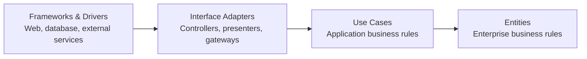

# Clean Architecture Skills

[](README.ko.md)

A collection of skills for AI coding agents that provide code review, architecture guidance, and refactoring suggestions based on **Clean Architecture** and **Kent Beck's simple design philosophy**.

Supports **Claude Code** and **OpenAI Codex** with native plugin marketplaces, **pi** as a Git package, and **OpenClaw** through its skill installer. The same `SKILL.md` files also work with AI coding assistants that use local skill directories.

## What's Included

### Clean Architecture

Reviews and guides code using Robert C. Martin's Clean Architecture principles.

- **Dependency Rule** — Detect dependencies that point in the wrong direction
- **Layer Boundaries** — Review Entities, Use Cases, Interface Adapters, and Infrastructure
- **Dependency Inversion** — Guide communication across architectural boundaries
- **SOLID Principles** — Review SRP, OCP, LSP, ISP, and DIP
- **Architecture Design** — Help design new features without coupling business rules to frameworks

### Kent Beck Style

Reviews code using Kent Beck's refactoring philosophy and simple design principles.

- **Code Smells** — Detect structural and readability problems
- **Refactoring** — Suggest small, behavior-preserving improvements
- **Simple Design** — Apply YAGNI, KISS, and the 4 Rules of Simple Design
- **Intention-Revealing Code** — Improve naming and make code easier to understand
- **Incremental Improvement** — Prefer small, safe changes over large rewrites

---

## Installation

### Claude Code

Add this repository as a plugin marketplace:

```bash
/plugin marketplace add nathankim0/clean-architecture-skills
```

Then install the skills you want.

#### Clean Architecture

```bash
/plugin install clean-architecture@clean-architecture-skills
```

#### Kent Beck Style

```bash
/plugin install kent-beck-style@clean-architecture-skills
```

You can install either skill independently or use both together.

### OpenAI Codex

Run these commands in your terminal to add the marketplace and install either or both plugins:

```bash
codex plugin marketplace add nathankim0/clean-architecture-skills
codex plugin add clean-architecture@clean-architecture-skills
codex plugin add kent-beck-style@clean-architecture-skills
```

Start a new Codex session after installation. You can also browse the configured marketplace with `/plugins` in Codex CLI.

For the Codex IDE extension, or a Codex version without `codex plugin`, use manual installation below.

### pi

Install both skills as one pi package:

```bash
pi install git:github.com/nathankim0/clean-architecture-skills
```

Run `/reload` in an active pi session, then invoke `/skill:clean-architecture` or `/skill:kent-beck-style`. Run `pi list` to check installed packages. To install a local clone instead, run `pi install .` from the repository root.

### Manual Installation

Clone the repository:

```bash
git clone https://github.com/nathankim0/clean-architecture-skills.git
cd clean-architecture-skills
```

#### OpenClaw

From the cloned repository, install either or both skills into OpenClaw's shared managed skill directory:

```bash
openclaw skills install ./plugins/clean-architecture/skills/clean-architecture --global
openclaw skills install ./plugins/kent-beck-style/skills/kent-beck-style --global
openclaw skills list --eligible
```

Run these commands on the machine running your OpenClaw Gateway. Start a new session after installation. These commands copy the skill folders; after `git pull`, repeat the install commands with `--force` to update the copies.

#### Shared Agent Skills Directory

For Codex, pi, and other tools that discover `~/.agents/skills/`, symlink either or both skill folders into that directory:

```bash
mkdir -p ~/.agents/skills
ln -s "$PWD/plugins/clean-architecture/skills/clean-architecture" ~/.agents/skills/
ln -s "$PWD/plugins/kent-beck-style/skills/kent-beck-style" ~/.agents/skills/
```

To make the skills available only in one project, use that project's `.agents/skills/` directory instead of `~/.agents/skills/`. Reload or restart your assistant if the skills do not appear. Choose one installation method per tool to avoid duplicate skills.

OpenClaw also discovers the shared user directory when using its default state directory. For a custom state directory, use the OpenClaw installer above.

Run `git pull` in this clone to update linked skills. Keep the clone at the same path so the links remain valid. If you previously copied a skill, move that installed folder aside before creating its link.

For other assistants, link or copy the same skill folders into the directory listed below.

### Other AI Assistants

| Assistant | Skill Directory |
|---|---|
| **Cursor** | `.cursor/skills/` |
| **Gemini CLI** | `~/.gemini/skills/` |
| **OpenCode** | `~/.config/opencode/skills/` |
| **OpenClaw** | `~/.openclaw/skills/` (default shared managed directory) |
| **pi** | `~/.pi/agent/skills/` |

---

## Usage

The skills are designed to work naturally from regular prompts.

In Codex, select a skill with `/skills` or mention it explicitly:

```text
$clean-architecture:clean-architecture Review the dependencies in src/domain.
$kent-beck-style:kent-beck-style Review this module for code smells and small refactorings.
```

### Review an Entire Project

```text
Review this project using clean architecture principles.
```

### Review a Specific Module

```text
Check the dependencies in src/domain and identify any clean architecture violations.
```

### Design a New Feature

```text
Design user authentication using clean architecture.
```

### Review Code Smells

```text
Review this code for code smells and suggest refactorings.
```

### Refactor Existing Code

```text
Help me refactor this long method using Kent Beck's approach.
```

### Review for Simplicity

```text
Check whether this implementation follows YAGNI and KISS.
```

### Improve Naming

```text
Improve the naming and readability of this module.
```

### Use Both Skills Together

```text
Review this feature for clean architecture violations, then suggest small refactorings to simplify the implementation.
```

---

## Clean Architecture

### The Dependency Rule

The central rule of Clean Architecture is:

> Source code dependencies must point inward, toward higher-level policies.



Arrows show source-code dependencies from outer implementation details toward inner business rules. Dependencies may skip layers while keeping this direction.

Business rules should not depend on databases, frameworks, UI libraries, or external APIs.

Instead, implementation details depend on abstractions defined closer to the business rules.

### Layer Responsibilities

| Layer | Responsibility | Examples |
|---|---|---|
| **Entities** | Enterprise business rules | `User`, `Order`, `Product` |
| **Use Cases** | Application-specific business rules | `CreateOrder`, `GetUserProfile` |
| **Interface Adapters** | Transform data between layers | Controllers, Presenters, Gateways |
| **Frameworks & Drivers** | External implementation details | React, Express, PostgreSQL |

### SOLID Principles

| Principle | Description |
|---|---|
| **SRP** — Single Responsibility | A module should have one reason to change |
| **OCP** — Open/Closed | Open for extension, closed for modification |
| **LSP** — Liskov Substitution | Subtypes must be substitutable for their base types |
| **ISP** — Interface Segregation | Don't depend on interfaces you don't use |
| **DIP** — Dependency Inversion | Depend on abstractions, not concrete implementations |

---

## Kent Beck Style

The Kent Beck skill focuses less on introducing architecture and more on making existing code **simpler, clearer, and easier to change**.

### Simple Design

Prefer code that:

1. Passes the tests
2. Reveals intention
3. Avoids duplication
4. Has the fewest unnecessary elements

The skill also applies principles such as:

- **YAGNI** — Don't build functionality before it is needed
- **KISS** — Prefer the simplest design that solves the current problem
- **Small Steps** — Refactor incrementally
- **Behavior Preservation** — Improve structure without changing behavior
- **Intention-Revealing Names** — Make the code explain itself

### Code Smells

The skill can identify common categories of code smells, including:

- Bloaters
- Object-Orientation Abusers
- Change Preventers
- Dispensables
- Couplers

It then recommends targeted refactorings instead of broad rewrites.

---

## Example Project Structure

A typical Clean Architecture project might look like this:

```text
src/
├── domain/                         # Entities
│   ├── entities/
│   │   ├── User.ts
│   │   └── Order.ts
│   └── value-objects/
│       └── Email.ts
│
├── application/                    # Use Cases
│   ├── use-cases/
│   │   ├── CreateOrderUseCase.ts
│   │   └── GetUserUseCase.ts
│   └── ports/
│       ├── input/
│       │   └── CreateOrderInput.ts
│       └── output/
│           └── UserRepository.ts
│
├── adapters/                       # Interface Adapters
│   ├── controllers/
│   │   └── OrderController.ts
│   ├── presenters/
│   │   └── UserPresenter.ts
│   └── gateways/
│       └── UserRepositoryImpl.ts
│
└── infrastructure/                 # Frameworks & Drivers
    ├── database/
    │   └── PostgresConnection.ts
    ├── web/
    │   └── ExpressServer.ts
    └── external/
        └── PaymentGateway.ts
```

This is an example, not a required directory structure.

Clean Architecture is primarily about **dependency direction and separation of policy from implementation details**, not specific folder names.

---

## Repository Structure

```text
clean-architecture-skills/
├── .github/workflows/validate.yml   # Linux and Windows checks
│
├── .agents/
│   └── plugins/
│       └── marketplace.json        # Codex marketplace
│
├── .claude-plugin/
│   └── marketplace.json            # Claude Code marketplace
│
├── plugins/
│   ├── clean-architecture/
│   │   ├── .claude-plugin/
│   │   │   └── plugin.json
│   │   ├── .codex-plugin/
│   │   │   └── plugin.json
│   │   └── skills/
│   │       └── clean-architecture/
│   │           └── SKILL.md
│   │
│   └── kent-beck-style/
│       ├── .claude-plugin/
│       │   └── plugin.json
│       ├── .codex-plugin/
│       │   └── plugin.json
│       └── skills/
│           └── kent-beck-style/
│               └── SKILL.md
│
├── tests/validation.test.mjs        # Metadata and executable example checks
├── package.json                    # pi package skill paths
├── README.md
├── README.ko.md
└── LICENSE
```

Keep each plugin's `.claude-plugin/plugin.json` and `.codex-plugin/plugin.json` identical. Both are regular JSON files so installation also works when Git symlinks are disabled. Both hosts use the same skill instructions under `skills/`. Marketplace catalogs remain separate because their schemas differ.

Run `node --test` with Node.js 24 or later to check manifest consistency and the executable skill examples. GitHub Actions runs these checks on Linux and Windows.

---

## Philosophy

These skills are not intended to enforce architecture mechanically.

The goal is to help AI coding agents reason about questions such as:

- Is business logic coupled to infrastructure?
- Are dependencies pointing in the right direction?
- Is an abstraction actually useful?
- Is this design more complicated than the problem requires?
- Can this code be improved through a small refactoring instead of a rewrite?
- Does the code clearly communicate its intent?

**Good architecture should make software easier to understand, change, test, and maintain — not merely add more layers.**

---

## Contributing

Contributions are welcome.

1. Fork the repository
2. Create a feature branch

```bash
git checkout -b feature/amazing-feature
```

3. Commit your changes

```bash
git commit -m "Add amazing feature"
```

4. Push the branch

```bash
git push origin feature/amazing-feature
```

5. Open a Pull Request

---

## References

### Clean Architecture

- [The Clean Architecture — Robert C. Martin](https://blog.cleancoder.com/uncle-bob/2012/08/13/the-clean-architecture.html)
- [Clean Architecture: A Craftsman's Guide to Software Structure and Design](https://www.amazon.com/Clean-Architecture-Craftsmans-Software-Structure/dp/0134494164)

### Refactoring & Simple Design

- [Refactoring — Martin Fowler](https://refactoring.com/)
- [Refactoring Catalog](https://refactoring.com/catalog/)
- [Implementation Patterns — Kent Beck](https://www.amazon.com/Implementation-Patterns-Kent-Beck/dp/0321413091)
- [Code Smells — Refactoring.Guru](https://refactoring.guru/refactoring/smells)

### Claude Code

- [Claude Code Plugin Marketplaces](https://code.claude.com/docs/en/plugin-marketplaces)

### OpenAI Codex

- [OpenAI Codex Skills](https://developers.openai.com/codex/skills/)
- [OpenAI Plugin Packaging and Marketplaces](https://developers.openai.com/plugins/build/plugins)

### OpenClaw and pi

- [OpenClaw Skills](https://docs.openclaw.ai/tools/skills)
- [OpenClaw Skills CLI](https://docs.openclaw.ai/cli/skills)
- [pi Skills](https://pi.dev/docs/latest/skills)
- [pi Packages](https://pi.dev/docs/latest/packages)

---

## License

MIT License.

Free to use, modify, and distribute.
