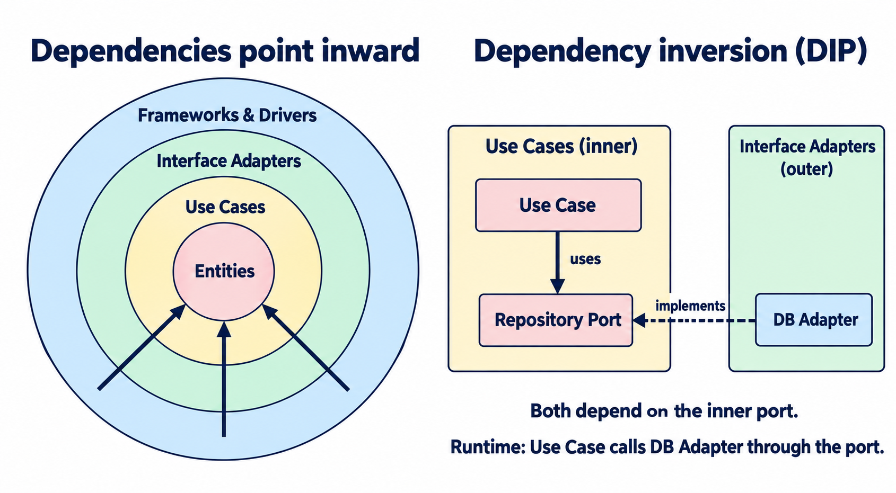

<div align="center">


# Clean Architecture Skills

**Clear boundaries. Simple code.**

Two skills for AI coding agents: review architecture, spot code smells, and improve code in small steps.

[](https://github.com/nathankim0/clean-architecture-skills/releases) [](https://github.com/nathankim0/clean-architecture-skills/actions/workflows/validate.yml) [](LICENSE)

English · [한국어](README.ko.md)

[Skills](#skills) · [Quick start](#quick-start) · [Usage](#usage) · [Supported agents](#supported-agents) · [Contributing](#contributing)

</div>

## Skills

| Skill | What it helps with |
| --- | --- |
| **[Clean Architecture](plugins/clean-architecture/skills/clean-architecture/SKILL.md)** | Review dependency direction, layer boundaries, and SOLID. Keep business rules independent of infrastructure. |
| **[Kent Beck Style](plugins/kent-beck-style/skills/kent-beck-style/SKILL.md)** | Find code smells, clarify names, and simplify code through small, behavior-preserving refactorings. |

Use either skill independently, or combine them to review the design and then simplify the implementation. Each is a portable `SKILL.md` file; the same instructions are shared across agents.

## Quick start

### Claude Code

Run inside Claude Code. Install either plugin or both:

```text
/plugin marketplace add nathankim0/clean-architecture-skills
/plugin install clean-architecture@clean-architecture-skills
/plugin install kent-beck-style@clean-architecture-skills
```

### OpenAI Codex

Run in your terminal:

```bash
codex plugin marketplace add nathankim0/clean-architecture-skills
codex plugin add clean-architecture@clean-architecture-skills
codex plugin add kent-beck-style@clean-architecture-skills
```

Start a new Codex session. Use `/plugins` to browse the marketplace. For the IDE extension or a version without `codex plugin`, use [manual installation](#manual-installation).

Windows plugin installs require [Git symlink support](https://gitforwindows.org/symbolic-links): enable Developer Mode or symlink privileges and clone with `core.symlinks=true`. If symlinks are unavailable, use manual skill-directory installation.

**Using another agent?** Jump to [pi](#pi), [OpenClaw](#openclaw), [GitHub Copilot / Amp](#github-copilot-and-amp), or [manual installation](#manual-installation).

## Usage

After installation, ask your agent to use a skill in a regular prompt:

```text
Use clean-architecture to review the dependencies in src/domain.
Point out violations and explain why each boundary matters.
```

```text
Use kent-beck-style to review this module.
Suggest small refactorings that preserve behavior and make the intent clearer.
```

For a combined review:

```text
Review this feature with clean-architecture and kent-beck-style.
Check the dependency direction, then suggest the smallest changes
that would make the code easier to understand and maintain.
```

You can also ask for a new feature design, review YAGNI and KISS, improve names, or refactor a long method.

<details>
<summary><strong>Explicit skill selection in Codex and pi</strong></summary>

In Codex, open `/skills` or mention an installed plugin skill directly:

```text
$clean-architecture:clean-architecture Review the dependencies in src/domain.
$kent-beck-style:kent-beck-style Review this module for code smells and small refactorings.
```

In pi, invoke `/skill:clean-architecture` or `/skill:kent-beck-style`.

</details>

## Supported agents

| Agent | Installation |
| --- | --- |
| **Claude Code** | [Native plugin marketplace](#quick-start) |
| **OpenAI Codex** | [Native plugin marketplace](#quick-start) or [shared skills directory](#manual-installation) |
| **pi** | [Git package](#pi) |
| **OpenClaw** | [Skills CLI](#openclaw) |
| **GitHub Copilot** | [GitHub CLI](#github-copilot-and-amp) or [shared skills directory](#manual-installation) |
| **Amp** | [GitHub CLI](#github-copilot-and-amp) or [shared skills directory](#manual-installation) |
| **Cursor** | [Local skills directory](#manual-installation) |
| **Gemini CLI** | [Local skills directory](#manual-installation) |
| **OpenCode** | [Local skills directory](#manual-installation) |

Choose one installation method per agent to avoid duplicate skills.

<a id="pi"></a>
<details>
<summary><strong>pi</strong> — install as a Git package</summary>

```bash
pi install git:github.com/nathankim0/clean-architecture-skills
```

Run `/reload` in an active session, then invoke `/skill:clean-architecture` or `/skill:kent-beck-style`. Check installed packages with `pi list`.

To install a local clone instead, run `pi install .` from the repository root.

</details>

<a id="openclaw"></a>
<details>
<summary><strong>OpenClaw</strong> — install with the Skills CLI</summary>

Clone the repository and install either or both skills on the machine running your OpenClaw Gateway:

```bash
git clone https://github.com/nathankim0/clean-architecture-skills.git
cd clean-architecture-skills
openclaw skills install ./plugins/clean-architecture/skills/clean-architecture --global
openclaw skills install ./plugins/kent-beck-style/skills/kent-beck-style --global
openclaw skills list --eligible
```

Start a new session after installation. The installer copies the skill folders; after `git pull`, repeat the install commands with `--force` to update them.

</details>

<a id="github-copilot-and-amp"></a>
<details>
<summary><strong>GitHub Copilot / Amp</strong> — install with GitHub CLI</summary>

From the Git repository where you want to use the skills, choose the command for your agent:

```bash
# GitHub Copilot
gh skill install nathankim0/clean-architecture-skills --all --agent github-copilot --scope project

# Amp
gh skill install nathankim0/clean-architecture-skills --all --agent amp --scope project
```

Both commands install into `.agents/skills/`, so one installation covers both agents in the same project. Check with `gh skill list --scope project`, then start a new session and ask your agent to use `clean-architecture` or `kent-beck-style`.

Use `copilot skill list` or `amp skill list` to check discovery in each configured client.

For Copilot cloud agent and Copilot code review, commit the installed `.agents/skills/` folders to the target repository. For a personal installation, replace `--scope project` with `--scope user`.

If your GitHub CLI does not include `gh skill`, use [manual installation](#manual-installation).

</details>

<a id="manual-installation"></a>
<details>
<summary><strong>Manual installation</strong> — shared directory and other agents</summary>

Clone the repository, then link either or both skills into `~/.agents/skills/`. Codex, GitHub Copilot, Amp, and pi can discover this shared directory.

The commands below use a macOS or Linux shell:

```bash
git clone https://github.com/nathankim0/clean-architecture-skills.git
cd clean-architecture-skills
mkdir -p ~/.agents/skills
ln -s "$PWD/plugins/clean-architecture/skills/clean-architecture" ~/.agents/skills/
ln -s "$PWD/plugins/kent-beck-style/skills/kent-beck-style" ~/.agents/skills/
```

For project-only use, link or copy the skill folders into the target project's `.agents/skills/` instead. On Windows, copy the folders into your agent's skills directory, or create directory links using your shell's equivalent commands.

Reload or restart your agent if the skills do not appear. Keep the clone at the same path so the links remain valid. Run `git pull` to update linked skills; copied folders must be copied again after updates. If a skill is already installed, move the old folder aside before creating its link.

For other agents, link or copy the **individual skill folders containing `SKILL.md`** into the appropriate directory:

| Agent | Skills directory |
| --- | --- |
| Cursor | `.cursor/skills/` in the target project |
| Gemini CLI | `~/.gemini/skills/` |
| OpenCode | `~/.config/opencode/skills/` |
| OpenClaw | `~/.openclaw/skills/` (default shared managed directory) |
| pi | `~/.pi/agent/skills/` |
| GitHub Copilot | `.agents/skills/` (project) or `~/.copilot/skills/` (personal) |
| Amp | `.agents/skills/` (project) or `~/.config/agents/skills/` (personal) |

OpenClaw also discovers `~/.agents/skills/` with its default state directory. For a custom state directory, use its [Skills CLI](#openclaw).

</details>

## The approach

### Dependencies point inward

**Keep business rules independent.** Source-code dependencies point inward, toward higher-level policies:



The circles show nested boundaries. Arrows represent source-code dependencies, not execution order. Dependencies can skip layers while keeping this direction. Neither a circular drawing nor exactly four layers is required; the dependency rule is. See [Robert C. Martin's original explanation](https://blog.cleancoder.com/uncle-bob/2012/08/13/the-clean-architecture.html).

### Dependency inversion (DIP)

**High-level policies and low-level details depend on abstractions; those abstractions do not depend on implementation details.** As shown on the right of the image, define the port (interface) in the inner layer that needs it, and make the outer adapter implement it.

For example, `GetUserUseCase` references only `UserRepository`; the outer `PostgresUserRepository` implements that port. At runtime, the use case calls the supplied implementation through the port. This is how calls can go outward while source-code dependencies stay inward. Dependency injection (DI) supplies the implementation; injection alone does not satisfy DIP if the use case still depends on the concrete class.

### Small refactorings

**Improve code in small steps.** Follow Kent Beck's simple design priorities: pass the tests, reveal intention, avoid duplication, and keep unnecessary elements out. Use abstractions when they solve a real problem.

The [Clean Architecture skill](plugins/clean-architecture/skills/clean-architecture/SKILL.md) and [Kent Beck Style skill](plugins/kent-beck-style/skills/kent-beck-style/SKILL.md) contain the full review checklists, report formats, and TypeScript, Python, and Java/Kotlin examples.

## Contributing

Issues and pull requests are welcome, especially concrete review examples, clearer guidance, and verified agent installation fixes.

- Edit the shared instructions in `plugins/<name>/skills/<name>/SKILL.md`.
- Edit each plugin's `.codex-plugin/plugin.json` as the single manifest source. `.claude-plugin/plugin.json` is a relative symlink to it. The marketplace catalogs stay separate because their schemas differ.
- Keep the English and Korean READMEs in sync.

Run the checks with **Node.js 24 or later**; no dependencies need to be installed:

```bash
node --test
```

GitHub Actions checks plugin metadata and executable skill examples on Linux and Windows.

## References

- [The Clean Architecture — Robert C. Martin](https://blog.cleancoder.com/uncle-bob/2012/08/13/the-clean-architecture.html)
- [Refactoring and the Refactoring Catalog — Martin Fowler](https://refactoring.com/)
- [Implementation Patterns — Kent Beck](https://www.amazon.com/Implementation-Patterns-Kent-Beck/dp/0321413091)

<details>
<summary><strong>Official agent documentation</strong></summary>

| Agent | Documentation |
| --- | --- |
| Claude Code | [Plugin marketplaces](https://code.claude.com/docs/en/plugin-marketplaces) |
| OpenAI Codex | [Skills](https://developers.openai.com/codex/skills/) · [Plugin packaging](https://developers.openai.com/plugins/build/plugins) |
| pi | [Skills](https://pi.dev/docs/latest/skills) · [Packages](https://pi.dev/docs/latest/packages) |
| OpenClaw | [Skills](https://docs.openclaw.ai/tools/skills) · [Skills CLI](https://docs.openclaw.ai/cli/skills) |
| GitHub Copilot | [Agent Skills](https://docs.github.com/en/copilot/concepts/agents/about-agent-skills) · [GitHub CLI installation](https://cli.github.com/manual/gh_skill_install) |
| Amp | [Skills](https://ampcode.com/docs/customize/skills) |

</details>

## License

[MIT](LICENSE) — use, modify, and share.
